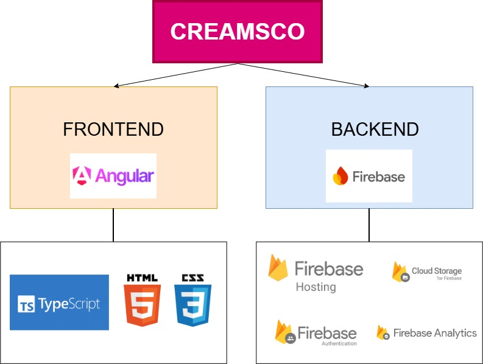
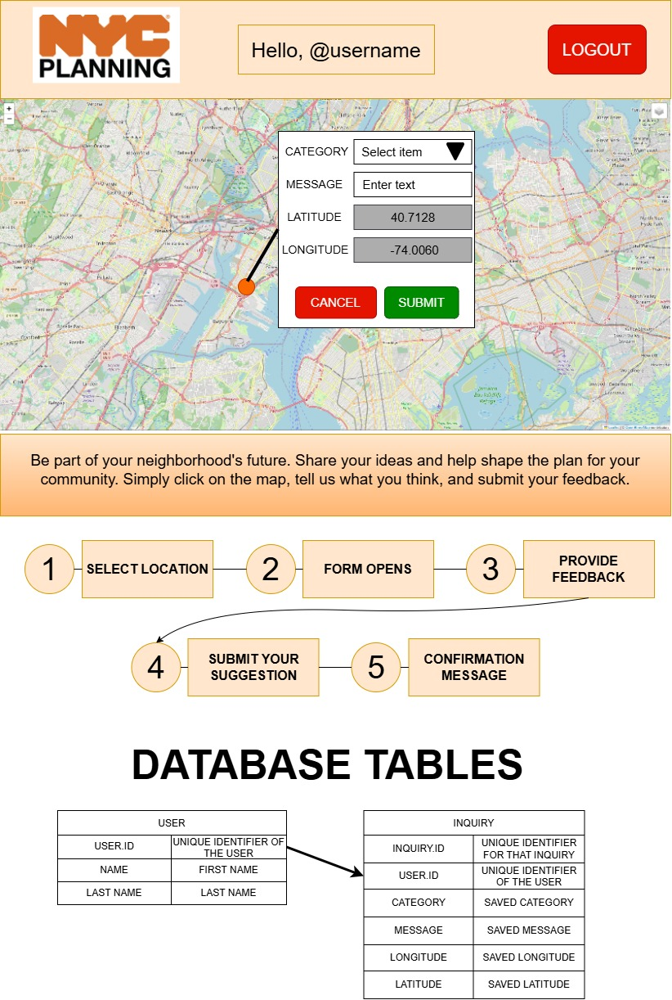

## PART A: WEB DEVELOPMENT

## A.1 WEBSITE CONTRIBUTION

In addition to Bostonian, the interactive Progressive Web App (PWA) I presented during the first interview, which allows users to explore Boston’s landmarks and restaurants in a more engaging and interactive way, I have developed two other websites that may be worth showcasing, although they are not directly related to urban development.

Links to the three websites: 

1. Bostonian: https://toursinteractive.netlify.app/ 

2. **Creamsco.com: https://creamsco.com/#/** 

3. Scanexgym.com: https://scanexgym.com/ 

For this section, I will focus on Creamsco.com, as it was developed for professional use and is currently live, serving real users.

# CREAMSCO.COM

## GITHUB LINK - CODE BASE: https://github.com/janmollet/CREAMSCO_website/tree/main/Dermadata 

## MOTIVATION

About a year ago, my father, a dermatologist based in Barcelona, Spain, approached me with a challenge he was experiencing in his professional practice.

Over the years, keeping track of the wide range of medications and medical products available on the market has become increasingly difficult for healthcare professionals. Doctors need to know which products are available and identify the most appropriate options for different clinical situations. Traditionally, much of this information was provided through extensive reference books containing thousands of pages. Finding a specific product could be time-consuming, and keeping up with changes to the catalog's content and layout made it even more challenging to maintain an up-to-date overview.

My father had been thinking about how this process could be improved. What if the same information could be presented through a simple, visual, and easy-to-navigate website, updated annually and equipped with filters to help doctors narrow down their searches and find relevant products more efficiently?

That was the starting point for Creamsco. I decided to collaborate with my father as a web developer to turn his idea into a practical digital tool, making medical product information easier to navigate and more accessible to the professionals who rely on it. 

## OBJECTIVE

The objective was to create a simple, user-friendly digital tool that dermatologists could use in their daily practice to find the most relevant products for their patients. Currently, the platform focuses exclusively on dermatology, as the catalog covers products related to skin care and treatment.

Beyond its professional use, the website was also made accessible to the general public. This allows individuals to explore available products, learn more about their options, and gain a better understanding of the products that may be relevant to their needs before consulting a healthcare professional.

## WEB DEVELOPMENT STACK

To develop Creamsco as a web-based software solution, I used the following technologies:

1. **Angular:** The main web development framework used to build the application. It allowed me to structure the application into reusable components and integrate HTML, CSS, and TypeScript to create an interactive user experience.

2. **HTML:** Used to define the structure and content of the website, organizing the different elements and components of each page.

3. **CSS and Bootstrap:** Used to style the website and create a consistent visual identity. Bootstrap provided a collection of predefined styling classes and responsive layout components, making it easier to adapt the interface to different screen sizes and devices, including desktops, tablets, and mobile phones.

4. **Firebase:** Google's backend-as-a-service platform, used to support the application's backend infrastructure without requiring me to manage my own servers. It provides services that simplify application development, data management, and deployment.

## OVERVIEW TECH STACK

### FRONTEND

The application follows Angular's component-based architecture, with each page or functional section organized into its own component and associated files. Each component typically contains an HTML file for its structure, a CSS file for its styling, and a TypeScript file for its logic and behavior.

This modular approach makes the codebase easier to maintain and scale, as individual components can be modified or updated independently without affecting the entire application. It also improves code organization, simplifies debugging, and makes it easier to introduce new features as the platform evolves.

### BACKEND

Firebase was particularly useful for this project because it provides several backend services through a single platform, allowing me to manage different aspects of the application without having to build and maintain a separate backend infrastructure for each one.

The main services used or managed through Firebase include:

- **Database:** Store and organize application data in collections and documents, allowing the application to retrieve and manage structured information efficiently.

- **Storage:** Store and manage larger files, such as product images and other media assets.

- **Authentication:** Manage user access through email and password authentication, including email verification to confirm users' email addresses.

- **Hosting and deployment:** Deploy the website and connect a custom domain, making the application accessible to users online.

- **Analytics:** Monitor website usage and user engagement through performance metrics and analytics reports, helping to understand how users interact with the platform.

## THE BRIDGE: HOW DOES THE FRONTEND CONNECT TO THE BACKEND?

Creamsco uses separate development and production environments to manage the connection between the Angular frontend and the Firebase backend. This separation allows me to test new features and changes safely before making them available to real users.

1. **Development environment:** A dedicated TypeScript environment configuration connects the application running locally on localhost to a separate development Firebase project. This environment replicates the production setup as closely as possible, allowing me to test new features, identify bugs, and validate changes without affecting the live application or its data.

2. **Production environment:** A separate TypeScript environment configuration connects the deployed application to the production Firebase project. This is the environment used by real users and contains the live application data.

This approach establishes a safer and more maintainable development workflow. I can implement and test changes locally, verify that everything works as expected, and then deploy the updated application to production. By keeping development and production data separate, I reduce the risk of introducing bugs or accidentally modifying live data while developing new features.

## HOW TO ACCESS IT

Since there is a layer of protection (auth), you can access the website and test it out feel free to use the following credentials:

**username:** jan10mollet@gmail.com
**password:** Wxy_test10!

--------------------------------------------------------------------------------------------------------------------------------------------------------------------------------

# A.2 DEVELOPING A WEBSITE FOR A SPECIFIC SCENARIO

------------------

Scenario: *You are working with the NYC Department of City Planning on a neighborhood plan. As part of the process, we are developing a website to solicit community input on what the plan should include. The website must have an interactive map with context layers and a feature that allows community members to add  comments to the map to share ideas for the plan. The comments should not be publicly visible on the site but must be saved along with their location information so that they can later be analyzed.*

------------------

I believe the first step should be to establish a secure authentication layer before allowing users to access the interactive mapping interface. This would allow us to manage participation, associate multiple comments with the same user throughout the planning process, and reduce the risk of spam or unauthorized submissions.

Each participant would have a unique identifier linked to their account, allowing their comments to be stored alongside the geographic coordinates of the locations they reference. This would make it easier to analyze participation patterns and understand how community members contribute to the planning process over time.

Once authenticated, users would access a simple, visually engaging interface centered around an interactive map of the neighborhood. The map would display relevant contextual layers, such as land use, transportation infrastructure, public spaces, and existing community facilities. Users could toggle these layers on and off, selecting the information most relevant to their interests.

The interface should make submitting feedback as intuitive as possible. Participants could click on a specific location on the map, complete a short form describing their comment or suggestion, and submit it for later analysis by the planning team. Comments would be stored privately rather than displayed publicly on the website.

At the bottom of the page, I would include a brief, welcoming explanation of the initiative to encourage participation. For example:

*“Be part of your neighborhood's future. Share your ideas and help shape the plan for your community. Simply click on the map, tell us what you think, and submit your feedback.”*

To make the process as intuitive as possible, I would also include a short sequence of instructions explaining how to submit a suggestion:

**1. Select a location:** Click on the specific point on the map where you would like to make a suggestion or raise a concern.

**2. Open the form:** A form will automatically appear after you select a location on the map.

**3. Provide your feedback:** The form will include the following fields:

        - Inquiry type (dropdown): Select the category most relevant to your suggestion, such as streets, buildings, parks, or public transportation.

        - Comments: Describe your idea, concern, or suggestion.

        - Latitude: Automatically populated based on the selected location and not editable by the user.

        - Longitude: Automatically populated based on the selected location and not editable by the user.

**4. Submit your suggestion:** Click the submit button to save your feedback and its geographic location for subsequent analysis by the planning team.

**5. Confirmation:** A thank-you message will appear to confirm that your suggestion has been submitted successfully.

*There will also be a **CANCEL** button so the user can correct the location or start over. The information won't be saved until the users **SUBMIT** the form*

Take a look at a basic design for that type of website:

### FRONTEND

I would use React to develop the frontend, with HTML to structure the interface and CSS to handle its styling and responsive layout. React would allow me to build a component-based interface, including the interactive map, contextual layers, inquiry form, and submission confirmation.

### BACKEND:

For the backend, I would use Supabase to manage the database and user authentication. The database would consist of two main tables:

1. USER TABLE: store some data of the user such as NAME, LAST NAME and a USER.ID (unique identifier)

2. INQUIRY TABLE: store data for each specific inquiry such as CATEGORY, MESSAGE, LATITUDE (prefilled), LONGITUDE (prefilled) and also the USER ID and a INQUIRY.ID (Unique identifier for that specific record)

Supabase Authentication would handle account registration and login.

--------------------------------------------------------------------------------------------------------------------------------------------------------------------------------

## PART B: GEOSPATIAL PYTHON TEST

Everything is in the `part_b.ipynb` file.

## PART C: USE OF LLMs

